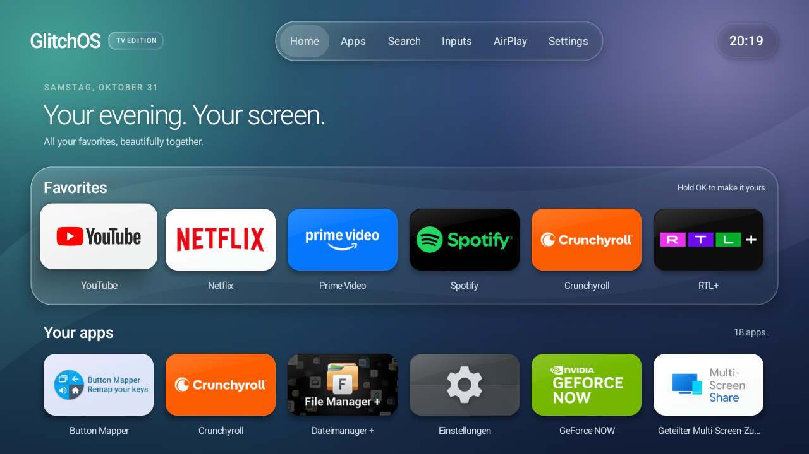
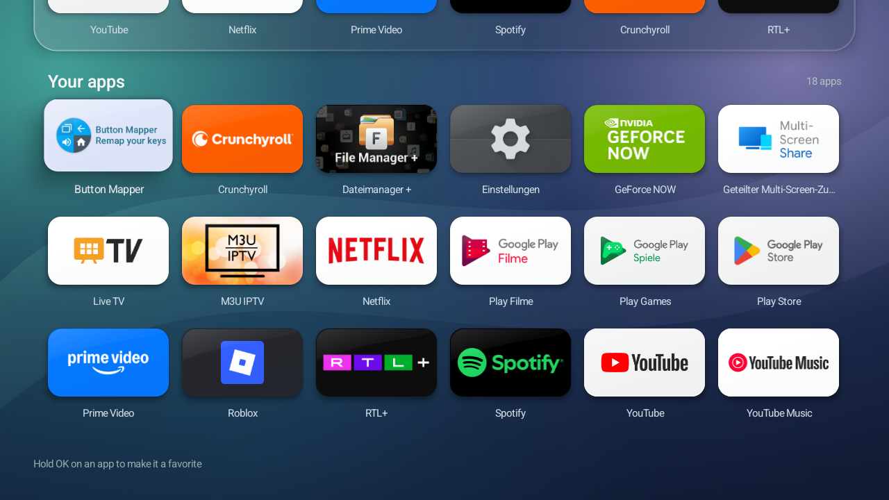
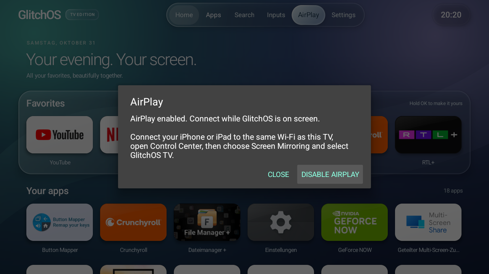

# GlitchOS TV installer

**A cleaner home screen for your Android TV. Your apps, your favorites, your remote.**

GlitchOS TV Edition gives your TV an Apple TV-inspired home screen with a liquid-glass appearance. This project includes the launcher, a Windows installer, optional app cleanup and a repair for a specific CHiQ AirPlay receiver. It works on top of Android: no rooting or replacement firmware is needed.

[**Download the project ZIP**](https://github.com/emiliaplays/GlitchOS-TV-installer/archive/refs/heads/main.zip) · [**Installation guide**](docs/GETTING-STARTED.md) · [**Let your coding AI help**](#let-your-coding-ai-help) · [Versioned releases](https://github.com/emiliaplays/GlitchOS-TV-installer/releases)

[](https://github.com/emiliaplays/GlitchOS-TV-installer/actions/workflows/checks.yml)



*A real screenshot from the tested TV, running launcher 1.3.1. App artwork comes from the apps installed on the TV.*

## What changes on your TV?

| Feature | What you get |
| --- | --- |
| **Your own home screen** | Favorites, installed apps, search and a clock, without a recommendation feed or launcher ads. |
| **Glass-style design** | Translucent panels, reflective edges and clear remote-focus highlights. |
| **Direct Home button** | On the tested firmware, Home opens GlitchOS without briefly showing Google TV first. |
| **Remote controls** | Navigate with the D-pad and OK. Hold OK on an app to manage favorites or open its app information. |
| **Useful shortcuts** | Open the TV's settings, input selector and supported AirPlay controls. |
| **Optional cleanup** | Disable seven selected preinstalled packages while keeping your entertainment apps. |
| **Backups and restore** | Save the previous configuration before applying changes, with a script to restore it. |

The launcher itself has no Internet permission or account requirement. The glass appearance uses gradients and translucent surfaces, not live background blur. The project does not promise measured speed gains, extra storage from disabling system apps, or system-wide ad blocking.

## See it on a real TV

| App library | AirPlay controls |
| --- | --- |
|  |  |
| Browse the apps already installed on your TV. | Connect from the iPhone's Screen Mirroring menu on a supported receiver. |

These are unedited device captures, not mockups. The AirPlay image shows the connection instructions; it is not a capture of a mirrored phone. [View full-size screenshots and capture details](docs/SCREENSHOTS.md).

## Will it work on my TV?

| Part | Requirement |
| --- | --- |
| **Windows installer** | Windows PowerShell 5.1 or PowerShell 7, Android TV 10/API 29 or newer, active Android owner user 0, and an authorized ADB connection. |
| **Launcher APK by itself** | Android TV 8/API 26 or newer. The installer needs the newer version above. |
| **AirPlay repair** | The exact supported CHiQ receiver binary. It is optional and is not a universal AirPlay app. |

Samsung Tizen, LG webOS and Roku TVs cannot run this Android launcher. Other Android TVs may handle Home, inputs and receiver services differently; meeting the Android version requirement does not mean a model has been tested.

**Tested TV:** the owner's CHiQ, reported as likely **L40G7B**, with verified Android model **Changhong AI PONT**, **Android 14**, build **UKNV.260603.001**. The configured TV worked for the tested launcher, Home, settings/input and AirPlay functions, including picture, sound, rotation and reconnection after reboot. The retail model has not been checked against its physical label.

The TV was configured before the portable installer was packaged. The installer passed 51 simulated-device assertions on PowerShell 5.1 and 7, plus a read-only preview on that TV; a fresh end-to-end install through the public script has not been repeated on a TV. [Read the complete test record](docs/TESTED-DEVICES.md).

## Let your coding AI help

**Give your coding AI [AI-INSTALL.md](AI-INSTALL.md), and ask it to help set up GlitchOS for you.** The file contains the repository location, compatibility checks, installation steps, optional choices and recovery instructions.

1. [**Download AI-INSTALL.md**](https://github.com/emiliaplays/GlitchOS-TV-installer/releases/download/v1.0.0/AI-INSTALL.md). You can also [read it on GitHub](AI-INSTALL.md) or [open the raw Markdown](https://raw.githubusercontent.com/emiliaplays/GlitchOS-TV-installer/main/AI-INSTALL.md) and save it as `AI-INSTALL.md`.
2. Attach that file to your coding AI or place it in its workspace.
3. Send this message:

   > Read AI-INSTALL.md and help me install GlitchOS TV on my TV. Check compatibility first, explain the changes and optional cleanup, keep my streaming apps, and save the restore backup. Tell me when you need me to use the TV remote.

A coding AI with terminal access to your Windows computer can run the setup commands. An AI that only chats can guide you through them. You still need to approve the debugging prompt on the TV and check the picture with your remote. The file does not give an AI automatic access to your devices.

## Prefer to install it yourself?

Follow the [step-by-step Windows guide](docs/GETTING-STARTED.md). It covers downloading the files, finding the TV's address, enabling debugging, connecting ADB, previewing the changes and installing.

**Before applying the default setup:** it makes GlitchOS your Home screen and disables the installed Google TV Home/setup packages. This affects Google TV's profile and setup flows until restored. Cleanup of the seven extra apps is a separate option. [See every change and how to undo it](docs/CHANGES-AND-RESTORE.md).

If you already have an authorized ADB connection, open PowerShell in the extracted project folder. Set these values to your own ADB path and the device address/serial shown by `adb devices`:

```powershell
$adb = 'C:\Tools\platform-tools\adb.exe'
$tv = 'YOUR_TV_ADDRESS:PORT'

# Preview only: no TV settings are changed.
powershell -NoProfile -ExecutionPolicy Bypass -File .\scripts\Install-GlitchOSTV.ps1 -Device $tv -AdbPath $adb -WhatIf

# Apply the default launcher and Home setup.
powershell -NoProfile -ExecutionPolicy Bypass -File .\scripts\Install-GlitchOSTV.ps1 -Device $tv -AdbPath $adb
```

Use the port your TV exposes; pairing-based wireless debugging does not normally use `5555`. Keep the backup path printed by the installer. Preview again with the same options if you choose cleanup or AirPlay.

## What about AirPlay?

The tested receiver disconnected because its advertised pairing capabilities did not agree with its connection response. A small correction restored working picture and sound while retaining the original hardware decoder.

The repository includes a **local repair builder**, not a downloadable CHiQ receiver APK. It checks the owner's original APK against the supported checksum, creates a separate repaired app and signs it with a local key. The original system app stays installed. Other receiver builds are rejected rather than patched with guessed offsets.

[Build and install the optional AirPlay repair →](docs/AIRPLAY.md)

Successful mirroring on the tested TV does not establish support for every iPhone, AirPlay 2, HomeKit or protected streaming content.

## Versions and downloads

| Component | Included version |
| --- | --- |
| Installer scripts | **1.0.0** |
| GlitchOS TV Edition launcher | **1.3.1**, version code **9** |
| Supported original AirPlay receiver | **CHAirPlay 2.0.20.33**, version code **2000033** |

[Download the current project](https://github.com/emiliaplays/GlitchOS-TV-installer/archive/refs/heads/main.zip) for the latest guides, screenshots and AI installation file. [Versioned releases](https://github.com/emiliaplays/GlitchOS-TV-installer/releases) preserve earlier bundles; the v1.0.0 bundle predates these documentation improvements. The launcher APK is unchanged.

The supplied launcher is in [`releases/`](releases/). Verify it using [SHA256SUMS](releases/SHA256SUMS). Version details are also available in [version.json](version.json) and the [changelog](CHANGELOG.md).

## Guides, help and source

| I want to… | Open this |
| --- | --- |
| Install for the first time | [Getting started](docs/GETTING-STARTED.md) |
| Give the task to a coding AI | [AI-INSTALL.md](AI-INSTALL.md) |
| Understand cleanup or undo the setup | [Changes and restore](docs/CHANGES-AND-RESTORE.md) |
| Fix the supported CHiQ AirPlay receiver | [AirPlay guide](docs/AIRPLAY.md) |
| Check what was tested | [Tested devices](docs/TESTED-DEVICES.md) |
| Build or modify the launcher | [Launcher source and build instructions](launcher/README.md) |
| Report a problem | [Open an issue](https://github.com/emiliaplays/GlitchOS-TV-installer/issues/new/choose) |

Share your model, Android version and the relevant error when asking for help. Keep backups, signing keys and personal device logs private; see [privacy notes](docs/PRIVACY.md).

For developers, the [automated checks](.github/workflows/checks.yml) verify release metadata, installer/restore behavior and the AirPlay patch. They use simulated device data and do not need a TV or vendor APK. Full receiver builds were also validated locally on PowerShell 5.1 and 7.

GlitchOS is an independent project, not affiliated with Apple, Google, CHiQ or Changhong. See [NOTICE.md](NOTICE.md) for distribution details; no broad open-source license has been selected.
