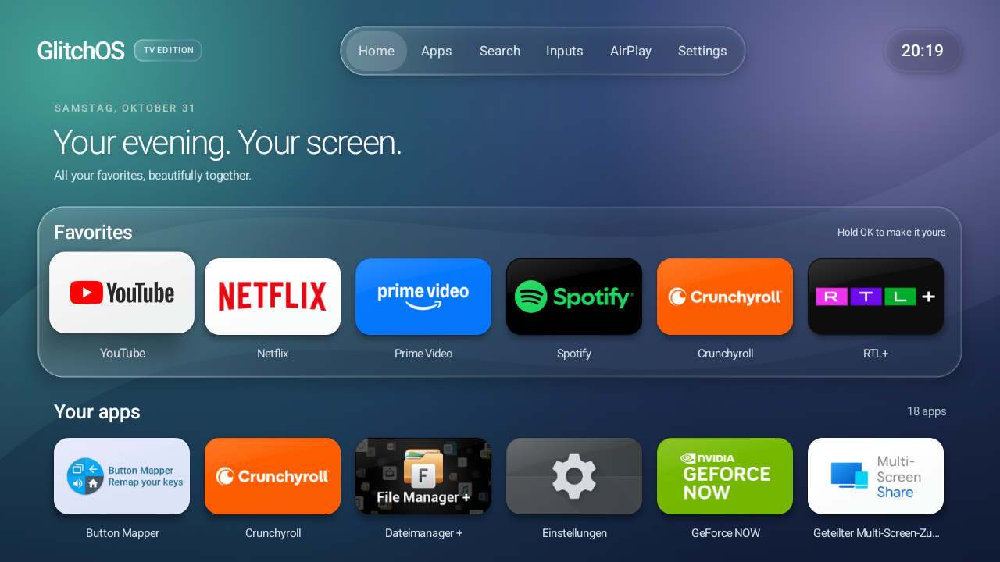
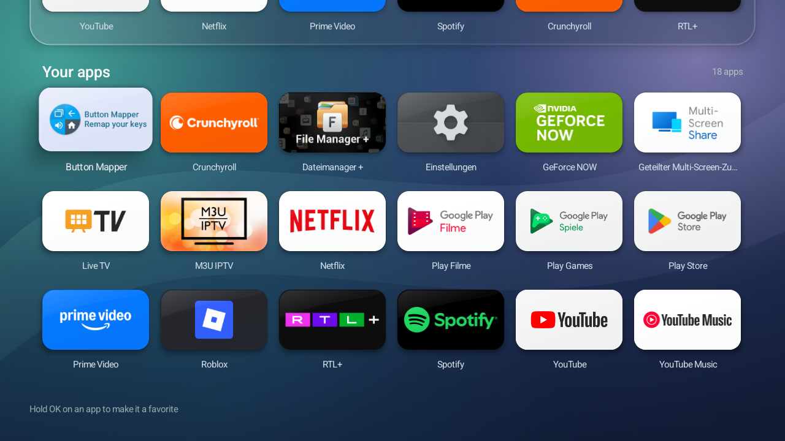
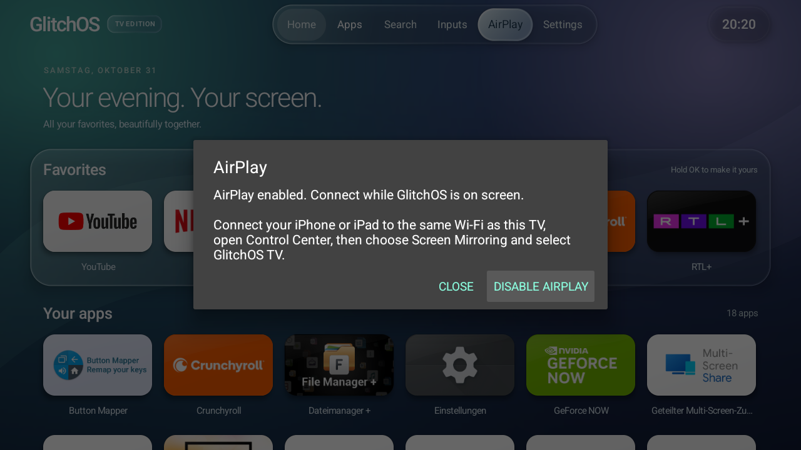

# GlitchOS TV Edition screenshots

These are real, unedited screenshots captured from the tested TV on **2026-10-31**, running **GlitchOS TV Edition 1.3.1**. They show the TV's existing apps and German regional date/app labels. Your installed apps, language and clock may look different.

The TV identifies itself as Changhong **AI PONT**, Android 14, build **UKNV.260603.001**. Its owner reports the retail model as likely **CHiQ L40G7B**. The images are 1280 × 720, matching the existing Android display override; capturing them did not change display settings. See the [device test record](TESTED-DEVICES.md).

## Home and favorites

The navigation bar opens Home, Apps, Search, Inputs, AirPlay and Settings. Favorites sit above the installed-app library. The highlighted card shows remote focus.

## Installed-app library

The Apps button scrolls to the library. Hold OK on an app to manage its favorite status or open its app information. App names and artwork come from the installed apps; pictured services are not bundled with GlitchOS and may require their own subscriptions.

## AirPlay controls

This is the launcher's connection-instructions dialog on the supported TV, with its receiver named **GlitchOS TV**. It is not a screenshot of a phone being mirrored. The owner separately verified picture, sound, rotation and reconnection after reboot. Receiver support is firmware-specific; read the [AirPlay repair guide](AIRPLAY.md).

[Back to the project](../README.md)
